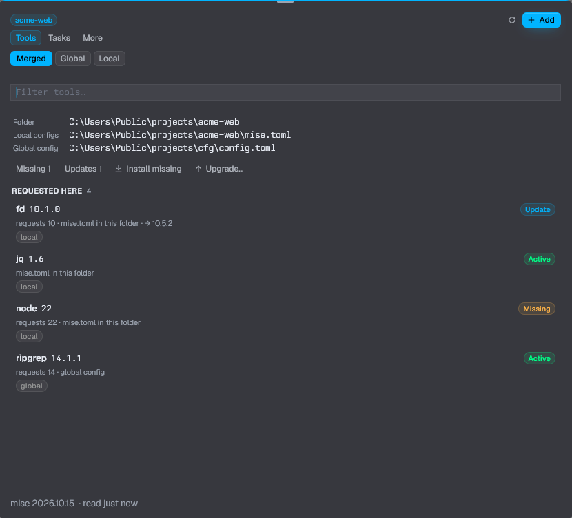
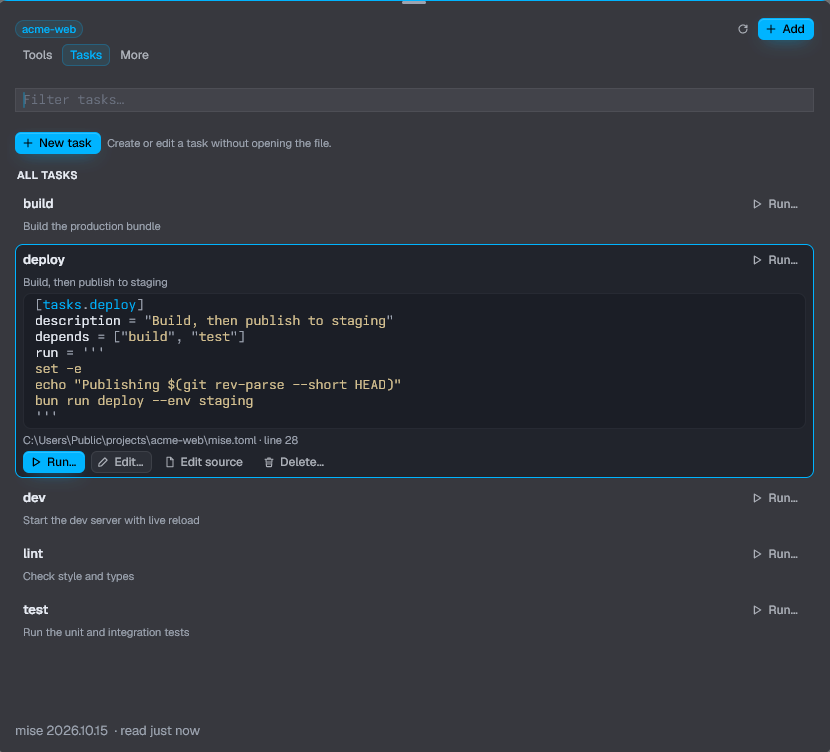
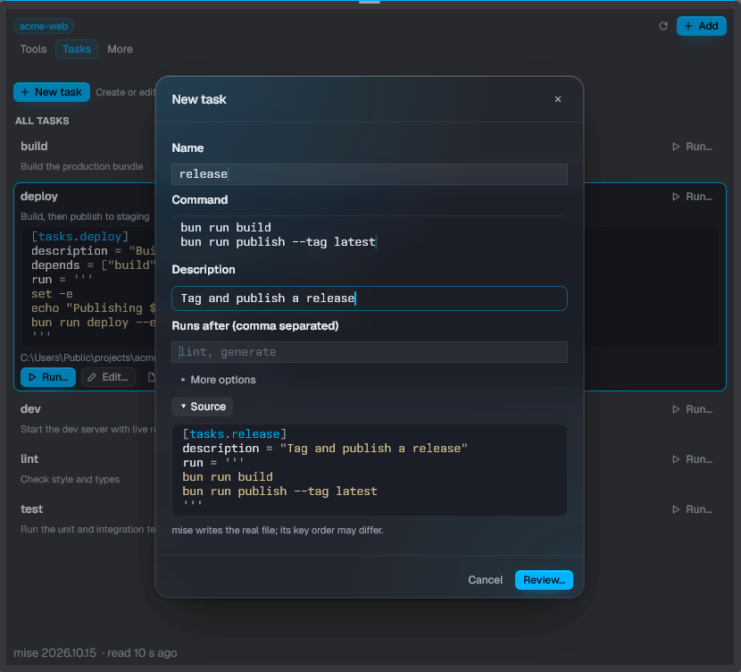

# mise for Tern

A native panel for [mise](https://mise.jdx.dev) inside [Tern](https://tern.so). See the tools a folder asks for, install what is missing, upgrade, add and remove tools, and create or edit tasks without leaving the terminal.

<p align="center">
  
  
</p>

## Install

```sh
tern plugin install github.com/gabrielmoreira/mise-tern-plugin
```

Then run **mise: Open** from the command palette (`Ctrl/Cmd+Shift+P`), or press `Ctrl+Alt+Shift+M`. The panel opens beside the focused terminal and follows it: change folder in that terminal and the panel shows that folder.

Update with the same command plus `--force`.

Requirements: Tern and mise on Windows or macOS. The plugin finds mise by itself (PATH, the usual install locations, `MISE_*` overrides) and lets you pick a binary if it cannot.

## What it does

**Tools**
- Three views of the focused folder: **Merged** (what mise resolves here), **Global** and **Local**. The header always names the folder and the config files behind the view, so "local" is never ambiguous.
- Each tool shows its version, status (Active, Missing, Update), where it is requested (`mise.toml` in this folder, a parent folder, the global config) and what version would replace it.
- Filter as you type, then install missing tools, upgrade, add or remove.

**Tasks**
- Lists every task mise knows for the folder, with its description and the TOML that defines it.
- **Run** opens a terminal beside the panel and runs `mise run <task>`.
- **New task** and **Edit** use a form. Fill in what you need and leave the rest empty; only the fields you fill are written. The command, and the description, are multi-line editors, so scripts stay readable. A live **Source** preview shows the exact TOML before anything is written.
- Editing rewrites only the lines you changed. Comments, other keys and neighbouring tasks stay as they are. **Edit source** opens the file at the task.

**More**
- **Overview**: the folders mise reports, plus `mise doctor`.
- **Config**: the config files that apply here, in order.
- **Activity**: every command the plugin ran, with its output.
- **Settings**: mise settings, and what the widget shows (local counters, global, mixed or merged; counters or tool names).

## Widget

Add **mise** in Tern's *Edit widgets* to get a compact chip with the counters of the focused folder, for example `3 local · 1 missing`. It is one chip and nothing else is added to the status line, so it never doubles up next to your other widgets. Hover for local, global and merged counts; click to open the panel.

## Every change is reviewed first

Nothing runs when you press a button. You get a plan that shows the exact command (or the exact lines of TOML), what it will touch, and a dry run when mise offers one. Run it, or back out. Task files are read back by mise after a write; if mise cannot read the result, the file is restored.

<p align="center">
  
</p>

## Where mise's folders are

The plugin never guesses where mise keeps its data. It asks mise (`mise doctor`, `mise config ls`) and shows what mise reports. If your user environment sets `MISE_*` or `XDG_*` variables that the running Tern was started without, a banner tells you which ones differ and that a restart of Tern picks them up.

## Develop

```sh
bun run test:unit          # pure logic, no mise or Tern needed
bun run test:integration   # real mise in a throwaway world (every MISE_*_DIR is a temp folder)
bun run test:ui            # a real, isolated Tern window driven through its control endpoint
bun run test               # all of it
bun run fixtures           # re-record what the installed mise prints
```

You need [Lune](https://lune-org.github.io/docs) on `PATH` (or `LUNE=/path/to/lune`), [Bun](https://bun.sh), mise, and for the UI tests Tern (`TERN_BIN` overrides where it is). The integration and UI suites run mise inside a temp world and Tern with its own config and daemon, so they never touch your tools, your config or your running Tern.

`bun scripts/screenshots.ts` regenerates the pictures above from a throwaway world.

Layout: `model.luau` parses mise output, `store.luau` holds state and actions, `view.luau` draws, `host.luau` is the panel block, `window.luau` is the window half (commands, widget), `tasks.luau` edits task TOML, `plan.luau` builds the reviewed plans.

## Known limits

- The panel is a block, not a sidebar item.
- Tool requests are changed through mise (`mise use`, `mise unuse`); there is no per-tool TOML editor. Task TOML is edited directly.
- A task whose command is several array entries, an inline table, or a multi-line string with a line-ending backslash is shown but not editable in the form; use **Edit source**.
- The widget counts available updates only after the Tools tab has loaded them.

## License

MIT
